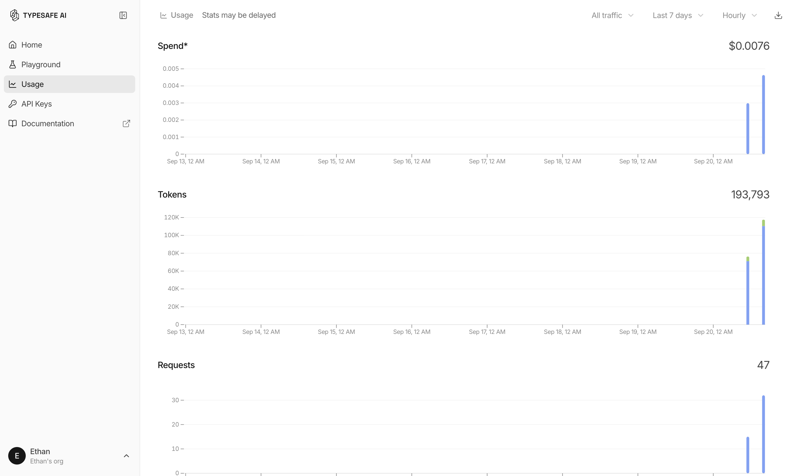

# Jev 评测，Browser Use 终局的曙光

#AI #BrowserUse #note

用 Jev + Codex 接管了 Browser Use，跑下来最直观的感受就是快，而且高效。

目前 Jev 和 Browser Use 的适配还不够完善，支持的操作类型有限，很多操作还需要额外补一套软键盘、软鼠标才能完成。但即便如此，这个速度和效率，已经让我觉得看到了 Browser Use 终局的曙光。

接管 Browser Use 需要自己写一点适配代码。我参考了 Browser Use 官方的实现，把适配放在了这个仓库里，感兴趣的可以试试。

[GitHub · EthanSMC/jev-codex](https://github.com/EthanSMC/jev-codex)

