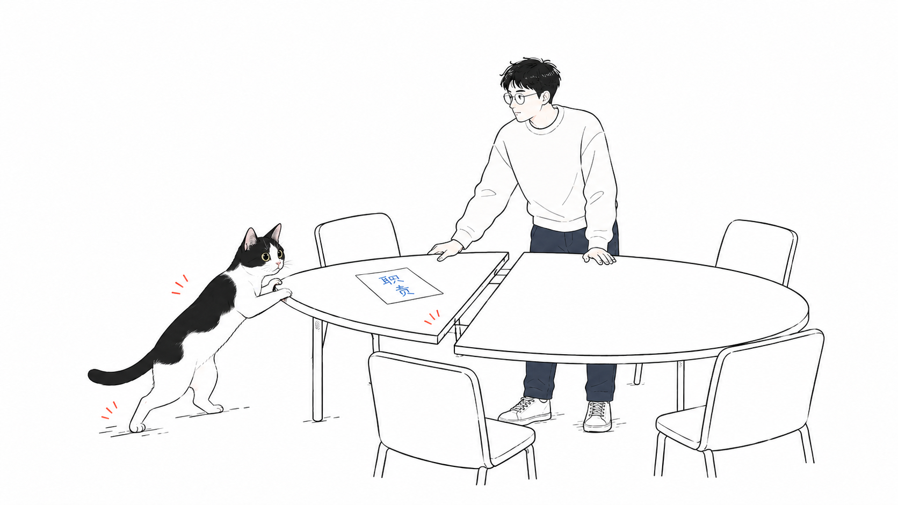
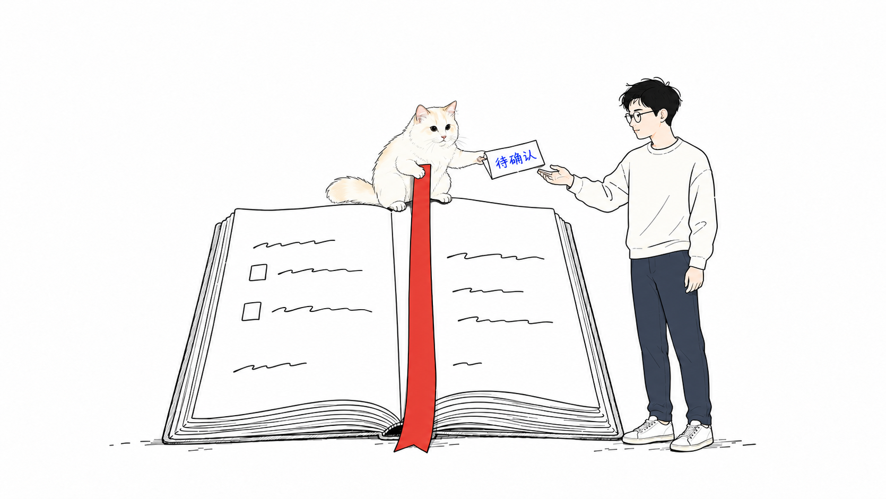

# Always-on agent，得先在公司里有个位置

#AI #Agent #组织 #产品 #essay

我对 always-on agent 的判断很直接。组织形式跟不上，这个东西就不会有市场。

我能理解一直在线、主动做事的吸引力。但一家公司的工作还是按原来的方式分配，agent 进来以后能负责什么？如果这个问题没变，多一个产品，也就是多一个可以叫来帮忙的工具。

## 多数人会把它放回熟悉的位置

对大多数人来说，这类产品和 Codex 没什么区别，甚至和 WorkBuddy、豆包也没什么区别。遇到事情，打开它，交代一下，等结果，自己接着往下做。

这是我对它们在工作中所处位置的判断。产品各自的能力、交互和适用场景当然有差异，我也没有把它们逐项测过一遍。可只要组织给它们安排的是同一个位置，使用者就很容易把它们归到同一类。

后台持续执行也已经有具体的产品形式。OpenAI 的[官方文档](https://learn.chatgpt.com/docs/automations?surface=app)写明，桌面端的定时任务可以在后台运行，处理本地项目时需要电脑开机、应用运行着。技术能让任务反复启动，公司还得决定启动之后的工作归谁管。

我觉得组织这一步跟不上，再强调 always-on，用户感受到的差别也会很有限。

## 我想给 agent 一个明确的位置

如果公司愿意重新定位 agent，我就觉得这个东西可以很牛逼。

我想看到的是，一件事明确归它持续负责。今天交代过，明天有了新情况，它仍然要接着跟。人不用每次从头说明，也不用先记起来“我该去叫一下那个 AI”。

拿持续跟进一项工作来说，我会先问它从哪里收到变化。只靠人把消息复制过去，人就仍然承担着盯进展的职责。公司要给它一个稳定的信息入口，让它知道工作什么时候开始、什么情况算有变化。

权限也得跟着这个职责走。能读取哪些资料，哪些动作可以直接做，到了哪一步需要人确认，都要有明确边界。否则它即使发现了问题，也只能等人重新把事情接回去。

我关心的还有交接。它交来一份结果时，接手的人能不能看见哪些已经完成、哪里还卡着、哪一个决定需要自己做？人处理完以后，这件事能不能继续回到它那里？

这会改变人的工作。原来亲自盯进展的人，要开始给 agent 定职责、看结果、处理它无法决定的部分。原来靠同事口头传递的信息，也要有 agent 能进入的地方。公司里谁能安排它做事，谁能修改它的职责，出了问题由谁负责，都得一起说清楚。

agent 可以承担执行和跟进，人仍然要承担授权、检查和最终决策的责任。我觉得把这些关系安排好，持续在线才会变成一种公司愿意依赖的工作方式。

## 我是这样理解 Muse 和 dots 的

我对 Muse、dots 这类尝试的理解，是它们想通过产品的形态，用自己的影响力推动组织形式的变化。

这只是我的推测。我没有它们的内部信息，也不能替团队确认动机。这里沿用 Muse、dots 这两个名字来谈我的判断，不展开具体产品功能。

我猜，想做这件事的企业，内部也会遇到很大的阻力。给 agent 一个持续负责的位置，就会碰到已有的分工和权限。某项工作交给它以后，谁来检查？原来负责的人接着做什么？出了问题谁兜底？这些安排都需要人接受，光有一个愿意试用的团队还不够。

所以我能理解一种推进方式。做产品的人先在自己的组织里用它，认真改一遍分工，让 agent 接下真实、持续的职责。用下来发现哪里行不通，就连着组织里的安排一起改。等自己跑顺了，再拿这套实际做法出去教育市场。

如果 Muse、dots 想走的是这条路，我觉得就很有意思。它们需要做出来的东西，会包括一家公司怎样与 agent 一起工作。

我会继续看这一点。下一次再有人讲 always-on agent，我最想问的是，它在公司里究竟持续负责哪件事，谁真的把这件事交给它了。
